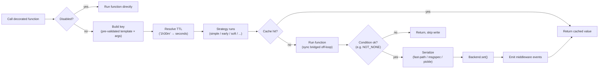
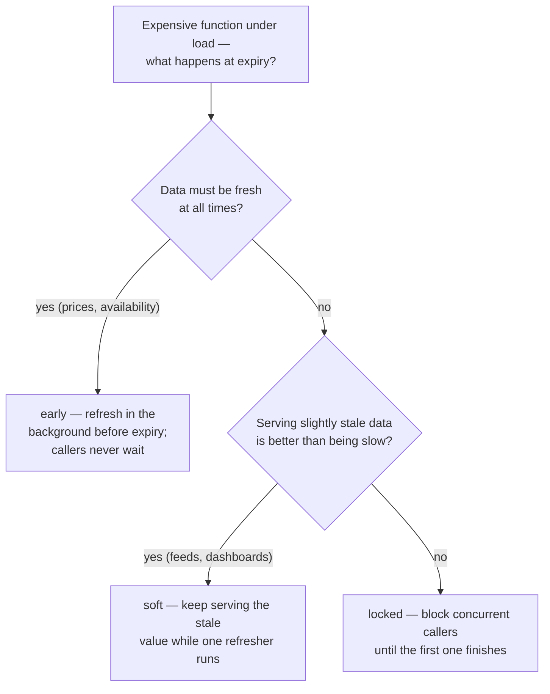

# cachery

**A fast, type-safe caching library for Python — sync and async, zero mandatory dependencies.**

cachery gives you the decorator API, TTL strings like `"1h30m"`, stampede protection, and tag-based invalidation you expect from a caching library — with sync **and** async decorators, key templates validated at decoration time, serialization that doesn't pickle everything, and a zero-dependency core.

```python
from cachery import cache

cache.setup("mem://")  # zero-dependency in-memory cache — a complete setup


@cache(ttl="1h", key="user:{user_id}")
async def get_user(user_id: int) -> dict: ...  # your database call
```

Sync functions work identically — the same decorator, the same behavior:

```python
@cache(ttl="3h")
def compute_report(customer_id: int, year: int) -> Report: ...
```

---

## Why cachery?

| Problem elsewhere | cachery's answer |
|---|---|
| Key typos fail **silently at runtime** | Templates validated **at decoration time** — `InvalidKeyTemplateError` with *"did you mean 'user_id'?"* at import, so CI catches it before it ships |
| Async-only decorators | Sync **and** async callables, one decorator |
| Custom backends need inheritance | Duck-typed `Protocol` — implement the methods, done |
| Pickle-everything serialization | Tag-dispatch codec: primitives skip serialization entirely, typed values use msgspec msgpack, pickle is only the fallback |
| Heavy dependency trees | **Core is stdlib-only.** Disk backend is stdlib `sqlite3`. Redis, msgspec, xxhash… are opt-in extras |
| No real multi-tier cache | `TieredBackend`: L1 memory + L2 anything, read-through/write-through |
| Decorated functions lose their signature | `ParamSpec` typing; `inspect.signature` equality is [tested](tests/core/test_key_validation.py) |
| A down cache crashes the app | Fail-soft by default — the wrapped function just runs; `suppress=False` opts into strictness |

## How a call flows



Every box is a seam you can plug into: the key builder validates templates, strategies control the hit/miss flow, the codec controls bytes on the wire, and middlewares observe it all.

## The strategy toolbox

```python
@cache.early(ttl="10m", early_ttl="7m")            # background refresh before expiry
@cache.soft(ttl="10m", soft_ttl="5m")              # serve stale while one refresher runs
@cache.hit(ttl="2h", cache_hits=100, update_after=90)
@cache.failover(ttl="2h", exceptions=(TimeoutError,))
@cache.locked(ttl="10s")                           # single-flight: one caller recomputes
@cache.rate_limit(limit=10, period="1m")           # quota per sliding window
@cache.circuit_breaker(errors_rate=50, period="1m", ttl="5m")
@cache.iterator(ttl="10m")                         # async/sync generators, cached as lists
@cache(ttl="1h", tags=["user:{user_id}"])          # invalidate("user:1") flushes all tagged keys
```

Why three stampede-protection tools? They fit different expensive-function profiles:



## Measured, not asserted

`uv run python perf/run.py` on the reference machine (Windows, Python 3.10):

| Benchmark | cachery | pickle |
|---|---:|---:|
| Hot path — 100 decorated calls | **~1.27 ms** | — |
| Key build + small payload serialize | **~10 µs** | — |
| 50-key dict round-trip | 35 µs | 13.6 µs |

For raw dict round-trips, pickle (13.6 µs) still beats our msgspec path (35 µs) — the safety check that keeps tuples/sets lossless costs real time. The fast path for primitives (`str`/`int`/`bool`/`bytes`/`None` — the majority of cached API responses) skips the codec entirely.

## Backends

```python
cache.setup("mem://")  # in-memory LRU (stdlib only)
cache.setup("disk:///var/cache/app.sqlite3?size_limit=2gb")  # sqlite3, WAL mode (stdlib only)
cache.setup("redis://localhost:6379/0")  # redis-py, RESP3, pipelined
cache.setup("tiered://mem+redis://localhost:6379/0")  # L1 memory + L2 redis
cache.setup(backend=my_duck_typed_store)  # Protocol — no inheritance
```

The same shared [contract test suite](tests/backends/test_backend_contract.py) runs against every backend, so they behave identically — including your custom one.

## Installation

```bash
uv add cachery                    # core — no dependencies
uv add "cachery[redis]"           # Redis backend
uv add "cachery[speed]"           # msgspec + xxhash fast paths
uv add "cachery[compress]"        # zstandard compression
uv add "cachery[prometheus]"      # metrics middleware
uv add "cachery[otel]"            # OpenTelemetry tracing middleware
uv add "cachery[all]"             # everything
```

## Documentation

The full documentation — tutorials, explanations, and recipes for every feature — is in [`docs/`](docs/) and builds with mkdocs:

```bash
uv sync --group docs
uv run mkdocs serve   # → http://127.0.0.1:8000
```

Start with [Getting started](docs/getting-started.md), then [Key building](docs/keys.md) (the static-validation feature), [Backends](docs/backends.md), and [Strategies](docs/strategies.md).

## Development

```bash
uv sync --all-extras --all-groups
uv run python -m coverage run -m pytest -q          # 350+ tests
uv run python -m coverage report --fail-under=90    # 90% coverage gate
uv run mypy                                         # strict, clean
uv run pyright src/cachery                          # strict, clean
uv run ruff check .                                 # clean
```

Redis integration tests run automatically when a server is reachable (`CACHEERY_TEST_REDIS_URL`), and skip cleanly otherwise. CI runs them against a real Redis container.

See [CONTRIBUTING.md](CONTRIBUTING.md) for the full workflow, including the 30-day dependency-freshness gate.

## License

MIT — see [LICENSE](LICENSE).

## Changelog & security

Notable changes per release: [CHANGELOG.md](CHANGELOG.md). To report a
vulnerability, see [SECURITY.md](SECURITY.md) — please use private GitHub
security advisories rather than public issues.
