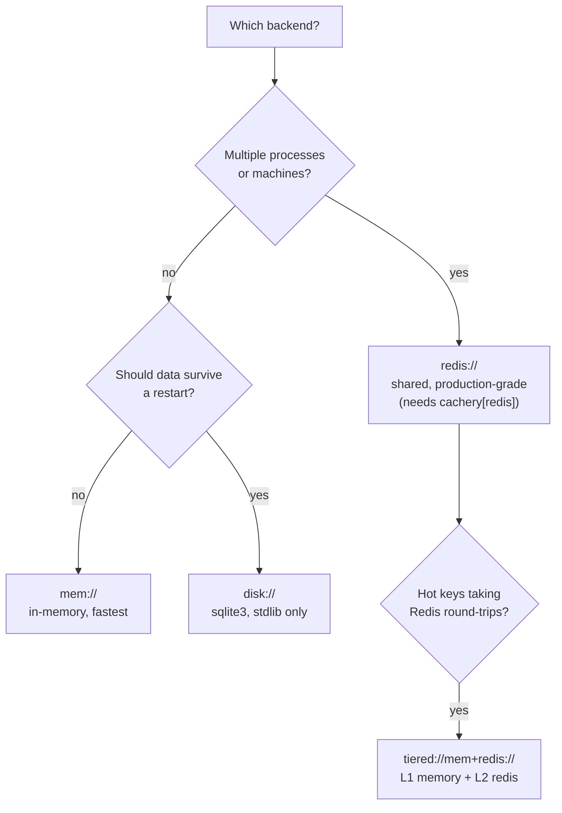
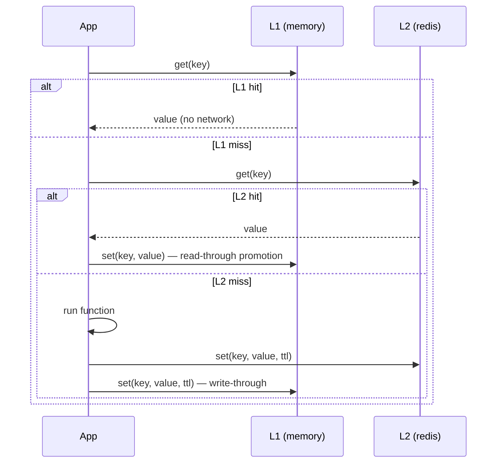

# Backends

A backend is where bytes live. cachery ships four — in-memory, disk, Redis, and tiered — behind one contract, and every one of them passes the same [contract test suite](https://github.com/seracoder/cachery/blob/main/tests/backends/test_backend_contract.py). You switch between them by changing one URL string.

## Choosing a backend



## In-memory (`mem://`)

```python
cache.setup("mem://")
cache.setup("mem://?size=10000")  # LRU-cap at 10,000 entries
```

- **Zero dependencies**, instant startup — the default for tests, scripts, and single-process apps.
- LRU eviction via an `OrderedDict`; `size=None` (no cap) is valid for short-lived processes.
- Expiry uses an **incremental reaper** (a min-heap drained opportunistically on each operation), not a periodic full-table scan — no latency spikes with millions of keys, and no background thread.
- Thread-safe: the same backend instance works from an event loop *and* the sync bridge's thread.

The one thing memory can't do: share data across processes. Run two gunicorn workers and each has its own cache — that's what Redis is for.

## Disk (`disk://`)

```python
cache.setup("disk:///var/cache/app.sqlite3")
cache.setup("disk:///var/cache/app.sqlite3?size_limit=2gb")  # evict near a size cap
cache.setup("disk://app.sqlite3")  # relative path
```

- **Zero dependencies** — stdlib `sqlite3`, WAL mode, `synchronous=NORMAL`: a good durability/speed trade-off.
- Survives process restarts; expired entries are purged on open.
- `size_limit` evicts soonest-expiring entries first when the payload bytes exceed the cap.
- All sqlite calls run in a thread pool, so the async contract never blocks the event loop.

Windows paths work: `disk:///C:/cache/app.sqlite3`.

Why not wrap `diskcache` (the popular option)? One less dependency to babysit, and full control of the schema — which is what makes `scan`/`delete_match` work correctly here, where diskcache's sharding breaks glob matching. If you prefer diskcache's battle-tested eviction, write a thin [custom backend](#custom-backends-via-protocol) for it — the contract is small.

## Redis (`redis://`)

```python
cache.setup("redis://localhost:6379/0")
cache.setup("redis://:password@redis.example.com:6379/1")
cache.setup("rediss://redis.example.com:6380")  # TLS
cache.setup("redis://localhost:6379/0?client_side=1")  # RESP3 + client name
```

Requires `pip install cachery[redis]` — the import is lazy, so the rest of the library works without it, and a missing install produces an actionable error:

```
ImportError: The Redis backend requires the 'redis' extra: pip install cachery[redis]
```

Implementation notes:

- **redis-py** (`redis.asyncio`), RESP3 when `client_side=1`, optional hiredis parser.
- Batch operations (`get_many`, `set_many`, `delete_many`) use **pipelining** — one round-trip instead of N.
- `scan` uses `SCAN` (never `KEYS`); `clear()` deletes via SCAN+DEL — **never `FLUSHALL`**, so sharing a Redis database with other applications is safe.
- Each backend instance gets its own connection pool, so instances can live on different event loops.

## Tiered (`tiered://`)

The "memory in front of Redis" pattern, first-class:

```python
cache.setup("tiered://mem+redis://localhost:6379/0")
```



- **Read-through**: L2 hits are promoted into L1 (capped by `l1_ttl_cap` so L1 can't outlive the source of truth).
- **Write-through**: writes land in L2 first (the durable tier), then L1.
- Deletes/`incr`/`expire` treat **L2 as authoritative** — L1 is always invalidated alongside.

The same composite works with any L2 — `tiered://mem+disk:///cache.sqlite3` gives you a restart-surviving disk cache with a hot memory layer.

```python
from cachery.backends.memory import MemoryBackend
from cachery.backends.redis import RedisBackend
from cachery.backends.tiered import TieredBackend

tiered = TieredBackend(
    l1=MemoryBackend(size=10_000),
    l2=RedisBackend(url="redis://localhost:6379/0"),
    l1_ttl_cap=60.0,  # promote into L1 with at most 60s of remaining TTL
)
cache.setup(backend=tiered)
```

## Custom backends via Protocol

No inheritance, no imports from cachery — if it has the methods, it works. This is a structural (`typing.Protocol`) contract:

```python
from typing import Any


class MyStore:  # your class, your package, no cachery import needed
    async def get(self, key: str) -> Any | None: ...
    async def set(
        self, key: str, value: Any, ttl: float | None = None, exist: bool | None = None
    ) -> bool: ...
    async def delete(self, key: str) -> bool: ...
    async def exists(self, key: str) -> bool: ...
    async def expire(self, key: str, ttl: float) -> bool: ...
    async def incr(self, key: str, delta: int = 1) -> int: ...
    async def clear(self) -> int: ...
    async def ping(self) -> bytes: ...


from cachery import cache

cache.setup(backend=MyStore(...))  # duck-typed — accepted as-is
```

That's the **whole** required surface: nine methods, all async except none. Batch operations (`get_many`, `set_many`, `delete_many`, `delete_match`, `scan`) have working default implementations — but for best performance or full functionality, implement them too:

```python
from collections.abc import AsyncIterator


class MyStore:
    ...  # the nine methods above

    async def get_many(self, *keys: str) -> tuple[Any | None, ...]:
        """Your native batch read — one round-trip."""

    async def scan(self, pattern: str, batch_size: int = 100) -> AsyncIterator[str]:
        """Yield keys matching a glob. Without this, delete_match(pattern) can't work."""
```

!!! note "`scan` powers pattern operations"
        `delete_match` and `get_match` are built on `scan`. A backend without `scan` simply can't support glob patterns — that's why the disk backend doesn't use diskcache's sharded layout.

There's also a convenience `BaseBackend` ABC that derives the batch operations from your single-key methods — subclass it only if you want the defaults spelled out. The Protocol path is the recommended one.

Verify your backend with the same contract suite the built-ins use:

```python
# tests/backends/test_my_store.py
import pytest
from tests.backends.test_backend_contract import *  # noqa: F401,F403


@pytest.fixture
async def any_backend():
    return MyStore(...)
```

## Backend URL reference

| URL | Backend | Extra |
|---|---|---|
| `mem://` | MemoryBackend (LRU) | — |
| `mem://?size=N` | MemoryBackend, capped | — |
| `disk:///path/app.sqlite3` | DiskBackend (WAL) | — |
| `disk:///path?size_limit=2gb` | DiskBackend, size-capped | — |
| `redis://host:6379/0` | RedisBackend | `redis` |
| `rediss://host:6380` | RedisBackend over TLS | `redis` |
| `tiered://mem+redis://host/0` | TieredBackend (L1 mem + L2 redis) | `redis` |
| `tiered://mem+disk:///path` | TieredBackend (L1 mem + L2 disk) | — |

Unknown query parameters are ignored; known ones are type-coerced (`true`/`false` → bool, digits → int). New schemes can be registered:

```python
from cachery.backends.registry import register_scheme

register_scheme("mystore", lambda url: MyStore.from_url(url))
cache.setup("mystore://production")
```
