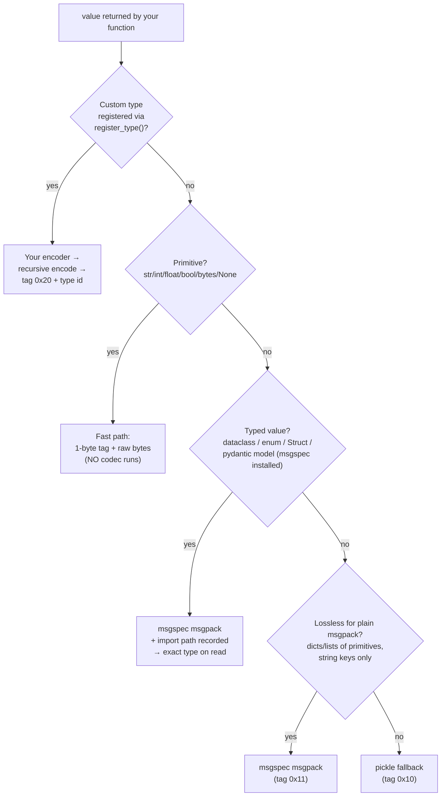

# Serialization

Cached values must become bytes (for disk and Redis) and back again. How that happens decides both **speed** and **what you're allowed to cache** — this page explains both, because they trade against each other.

## The dispatch chain

When your function returns `value`, cachery picks the first path that applies:



Every payload starts with a **1-byte tag** identifying its path, so decoding never guesses.

## The fast path (why primitives are free)

`str`, `int`, `float`, `bool`, `bytes`, `None` — the majority of real cached values (IDs, counts, flags, tokens) — skip msgspec and pickle entirely. A tag byte plus the raw value:

```python
from cachery.serialize import codec

codec.dumps(None)  # b'\x06'
codec.dumps(True)  # b'\x041'
codec.dumps(90)  # b'\x02' + b'90'
codec.dumps("hello")  # b'\x01' + b'hello'
```

This is the single biggest win over pickle-everything libraries: no framework code runs at all for the most common shapes.

## Typed values come back as themselves

msgspec (the `speed` extra) encodes dataclasses, enums, `msgspec.Struct`s, and Pydantic models **with their type recorded**, so decode reconstructs the original class — not a dict:

```python
import dataclasses


@dataclasses.dataclass(frozen=True)
class User:
    uid: int
    name: str


blob = codec.dumps(User(1, "alice"))  # tag 0x12 + type path + msgpack
back = codec.loads(blob)
isinstance(back, User)  # True — the dataclass itself
```

The type is recorded as an import path (`module:qualname`). On read, cachery imports it — which means:

- **Renamed/moved classes** raise a clear `SerializationError` ("Cannot resolve cached type 'app.models:User'") once the old entries age out, rather than returning wrong-shaped data.
- **Function-local classes can't be re-imported** — cachery detects `<locals>` in the qualname and routes them to pickle instead. Define cached dataclasses at module level.

Plain dicts/lists of primitives (string keys only) go through untyped msgpack — fast, and JSON-shaped, but they decode as plain `dict`/`list`.

## Why tuples and sets take the pickle path

msgpack has no tuple or set types: a tuple silently decodes as a **list**, and a set encodes as garbage. Rather than corrupt your data silently, cachery pre-checks the structure (exact-type walk) and routes anything containing tuples, sets, frozensets, non-string dict keys, or container subclasses to pickle, which round-trips them exactly.

```python
codec.loads(codec.dumps((1, "two", 3.0)))  # (1, 'two', 3.0) — a real tuple
codec.loads(codec.dumps({1, 2, 3}))  # {1, 2, 3} — a real set
```

This check is why a 50-key dict round-trip costs ~35µs where raw msgspec takes ~7µs: you're paying for the guarantee. If a hot path caches only lossless-safe shapes and you want that ~5× back, cache the components (lists, not tuples) or register a custom type.

## Pickle — the fallback, and its risks

Anything the other paths can't handle goes through pickle, so nothing is a hard blocker. Pickle is:

- **Fast** for arbitrary Python objects (often faster than our checked msgpack path).
- **Not safe for untrusted input** — cached bytes come from your backend; if an attacker can write to your Redis, they can execute code via pickle on load. Keep the backend secured (as you must anyway), or avoid caching unpicklable types.
- **Version-brittle** across Python/dependency upgrades — schema changes surface as decode errors.

If you'd rather fail loudly than ever pickle, validate what you cache: register explicit types (below) and keep an eye on the `error` middleware event for `SerializationError`s.

## `register_type` — teach cachery your classes

Full control over the wire format for any type, three calls to set up:

```python
from cachery.serialize.types import register_type
from cachery.serialize import codec


class Money:
    def __init__(self, cents: int) -> None:
        self.cents = cents


register_type(Money, lambda m: m.cents, Money)  # encode → int, decode ← Money

blob = codec.dumps(Money(250))
back = codec.loads(blob)
isinstance(back, Money) and back.cents == 250  # True
```

- The encoder's output must be something the codec already handles (primitives, dicts, lists…).
- Registration is by exact class path; subclasses match via MRO.
- Reading a payload whose type isn't currently registered raises `SerializationError` ("not registered on read") — stale entries age out via TTL rather than crashing forever.

## Compression

For large values (long strings, big payloads), wrap the payload in compression:

```python
cache.setup("mem://", compress="zlib")  # stdlib, default choice
cache.setup("redis://localhost/0", compress="zstd")  # needs cachery[compress]
```

Compression is applied to the whole encoded payload (tags `0xF0`/`0xF1`), and only pays off above roughly a few hundred bytes — small values grow slightly. `zstd` (zstandard) compresses better and faster than zlib; both round-trip transparently.

## Key hashing

Long or sensitive key components are digested before hitting the backend. The default is `hashlib.blake2b` (stdlib, fast, modern). With the `speed` extra, `xxhash` is available — roughly an order of magnitude faster for key-sized inputs:

```python
from cachery.serialize.hashing import digest

digest(b"user:1")  # blake2b hex
digest(b"user:1", alg="xxhash")  # xxh3_64 — needs cachery[speed]
```

For hiding key names from backend reads, see [Keys → prefixes and secrets](keys.md#prefixes-secrets-and-what-lands-in-your-backend) — that's HMAC territory (`hmac_digest`), not plain hashing.

## What you can cache, at a glance

| Value | Path | Comes back as | Needs extra? |
|---|---|---|---|
| `None`, `bool`, `int`, `float`, `str`, `bytes` | fast path | exact | — |
| dataclass / enum / Struct / pydantic (module-level) | typed msgpack | **the original type** | `speed` |
| dict/list of primitives (str keys) | msgpack | same shape | `speed` |
| tuple / set / anything else | pickle | exact | — |
| your class with `register_type` | your encoder | **your type** | — |
