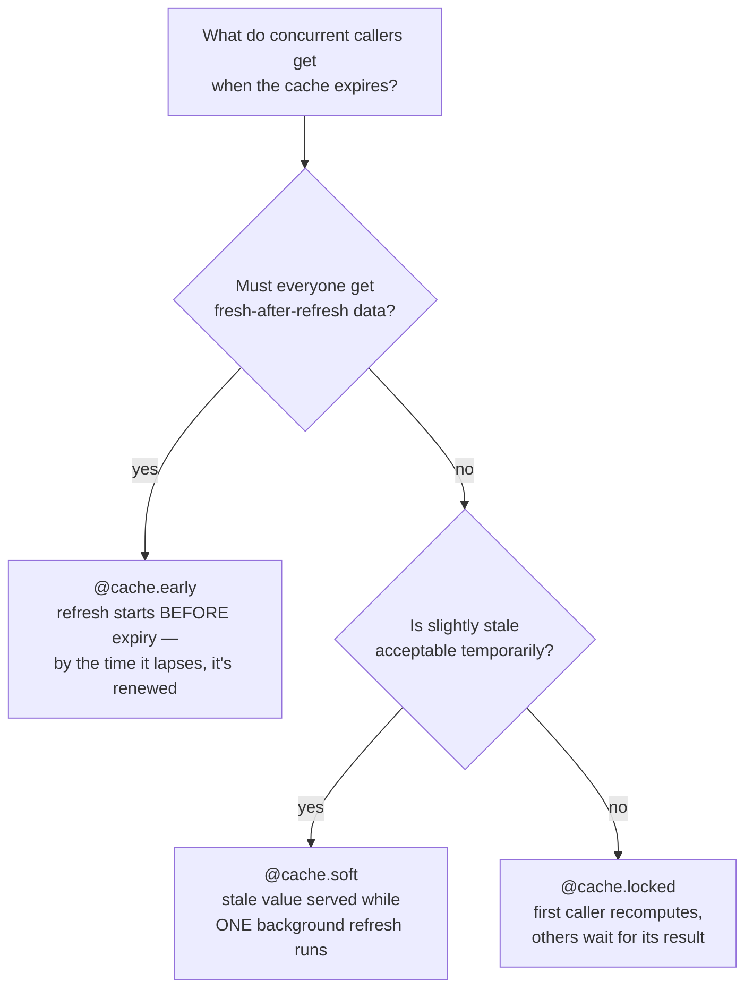
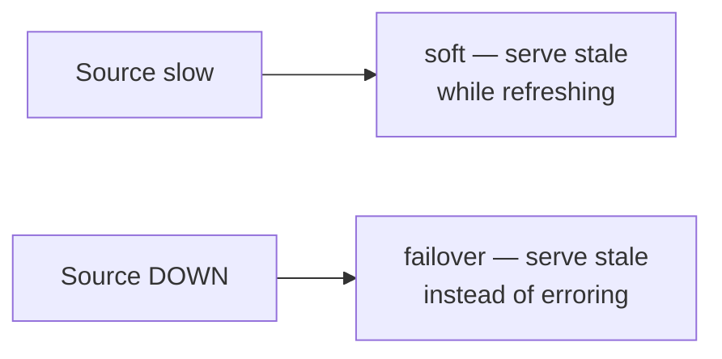

# Strategies

A strategy is the policy wrapped around your function: what counts as a hit, when the function actually runs, and what happens when things fail. One decorator family, ten strategies, each one small and composable with the rest of cachery.

All decorators work on **sync and async** functions identically.

## The plain cache

```python
@cache(ttl="1h")
async def get_user(user_id: int) -> dict: ...
```

Miss → run → store → return. Hit → return stored. That's `SimpleStrategy`, and it's all most functions need.

Two shared options worth knowing before the fancy stuff:

**`condition=`** — only cache results that pass a check:

```python
from cachery import NOT_NONE, time_condition


@cache(ttl="5m", condition=NOT_NONE)  # don't cache "not found" as if it were data
async def find_user(email: str) -> User | None: ...


@cache(ttl="1h", condition=time_condition(dt.time(9, 0), dt.time(17, 0)))
async def stock_price(symbol: str) -> float: ...


# only results computed during trading hours are cached


@cache(ttl="1h", condition=lambda result: result.status == "ok")
async def call_api() -> Response: ...
```

**`tags=`** — attach invalidation handles to entries (see [Keys → Tags](keys.md#tags-invalidation-for-the-real-world)).

## Stampede protection

The problem: your cached function takes 2 seconds and serves 500 requests. The TTL expires, and all 500 callers miss simultaneously — 500 concurrent executions of an expensive function, one database somewhere falls over. That's a cache stampede.

cachery has three tools, tuned to different definitions of "acceptable":



### `@cache.early` — refresh before the cliff

```python
@cache.early(ttl="10m", early_ttl="7m")
async def get_price(symbol: str) -> float: ...
```

Timeline for `ttl=10m, early_ttl=7m`:

```mermaid
gantt
    dateFormat X
    axisFormat %M:%S
    section early TTL
    Fresh — normal hits            :done, 0, 7
    Refresh window — hits + background recompute :active, 7, 10
    section What callers see
    Cached value the whole time — never a recompute on the hot path : 0, 10
```



After 7 minutes, hits **still return instantly** while a single background task recomputes. When the hard TTL would have expired, the fresh value is already there. Callers never see the cliff.

Use when: the data must stay fresh but the function is too slow to run on-demand (prices, availability, leaderboards).

### `@cache.soft` — stale while revalidate

```python
@cache.soft(ttl="10m", soft_ttl="5m")
async def get_feed(page: int) -> list: ...
```

The value physically lives `ttl + soft_ttl`. Inside `ttl`, normal hits. In the soft window, hits return the **stale** value and exactly one background refresh runs (single-flight via an atomic lock — even across processes on Redis). After `ttl + soft_ttl`, a real miss and a synchronous recompute.

Use when: a few minutes of staleness beats a slow response (feeds, dashboards, search). This is also failure insurance — see `failover` below for the crash case.

### `@cache.locked` — single-flight, full stop

```python
@cache.locked(ttl="1h")
async def build_report(report_id: int) -> Report: ...
```

On a miss, the first caller acquires a lock and computes; concurrent callers with the same key **wait** and receive the winner's result. If the winner takes longer than the lock's budget, waiters give up waiting and compute themselves (correctness over latency).

Use when: staleness is unacceptable and the function is expensive but not pathological (report generation, imports).

!!! note "Locks are backend-atomic"
        The lock is built on `set(key, ..., exist=False)` — atomic on every backend — so single-flight works across processes when your backend is shared (Redis/disk), and within one process for memory.

## `@cache.hit` — expire by popularity

TTL-based expiry treats a key hit 10,000 times and a key hit once identically. `hit` adds a count-based dimension:

```python
@cache.hit(ttl="2h", cache_hits=100, update_after=90)
async def trending_topics(region: str) -> list: ...
```

- After `update_after=90` hits: a background refresh starts (value stays served meanwhile).
- After `cache_hits=100` hits: the entry is force-expired — the next call recomputes synchronously.

Use when: popularity predicts staleness better than time does.

## `@cache.failover` — serve stale when the source dies

```python
@cache.failover(ttl="2h", exceptions=(TimeoutError, httpx.HTTPError))
async def get_catalog() -> list: ...
```

The decorator keeps a **stale copy** under a side key. When the wrapped function raises one of `exceptions`, the stale copy is served instead of the error propagating. If there's no stale copy (the source was already down at first call), the exception raises as usual.

Combined idea — `soft` for staleness-tolerance, `failover` for source failure; they compose on the same function only via separate caches, so pick by failure mode:



## `@cache.iterator` — cache generators

```python
@cache.iterator(ttl="10m")
async def all_pages(bucket: str):
    for page in fetch_pages(bucket):  # API pagination, DB cursors...
        yield page


# First call: generator runs once, materialized to a list, cached.
# Later calls: items are re-yielded from the list — the generator never re-runs.
async for item in all_pages("reports"):
    ...
```

Works with sync generators and plain functions returning lists too.

## `@cache.rate_limit` — quota the function itself

```python
from cachery.core.exceptions import RateLimitError


@cache.rate_limit(limit=100, period="1m")
async def call_third_party(endpoint: str) -> dict: ...
```

Counts **executions** per sliding window (per key — here, per endpoint). Beyond the quota, calls raise `RateLimitError` **without executing the function**. Counters live in the backend, so the quota is shared across processes.

This is flow control, not caching — deliberately: a cached response would still count as a "call" from the third party's perspective, so the limiter bypasses the cache entirely.

## `@cache.circuit_breaker` — stop hammering a dead dependency

```python
from cachery.core.exceptions import CircuitBreakerOpen


@cache.circuit_breaker(errors_rate=50, period="1m", ttl="30s", min_calls=3)
async def call_flaky_api(payload: dict) -> dict: ...
```

Tracks successes/errors per sliding window. Once at least `min_calls` samples exist and the error share crosses `errors_rate` percent, the circuit **opens** for `ttl` seconds: every call fails fast with `CircuitBreakerOpen` — no execution, no waiting for a timeout. After `ttl`, the next call is allowed through (half-open); success closes the circuit.

Combine with `failover` semantics by catching `CircuitBreakerOpen` at the call site and serving a local fallback.

## Tag invalidation recap

```python
@cache(ttl="1h", tags=["user:{user_id}"])
async def get_profile(user_id: int) -> dict: ...


@cache(ttl="1h", tags=["user:{user_id}"])
async def get_settings(user_id: int) -> dict: ...


await cache.invalidate("user:1")  # flushes both functions' entries for user 1
```

Full details and the `secret` interaction are in [Keys → Tags](keys.md#tags-invalidation-for-the-real-world).

## Reference table

| Decorator | On hit | On miss | On failure | Stampede behavior |
|---|---|---|---|---|
| `@cache` | return cached | run → store | raises | none |
| `@cache.early` | return cached; maybe trigger background refresh | run → store (envelope) | raises | pre-expiry refresh |
| `@cache.soft` | return cached or stale; maybe trigger single refresh | run → store | raises | stale-while-revalidate |
| `@cache.locked` | return cached | first runs, rest wait | raises | single-flight |
| `@cache.hit` | count; refresh at `update_after`; expire at `cache_hits` | run → store | raises | — |
| `@cache.failover` | return cached | run → store + stale copy | **serve stale** | — |
| `@cache.rate_limit` | n/a (bypasses cache) | run if under quota | `RateLimitError` over quota | — |
| `@cache.circuit_breaker` | n/a (bypasses cache) | run if circuit closed | opens circuit | — |
| `@cache.iterator` | re-yield cached list | run once, cache list | raises | — |

Every strategy: `ttl` accepts seconds / `timedelta` / `"1h30m"` / callables evaluated per call with the bound arguments.
